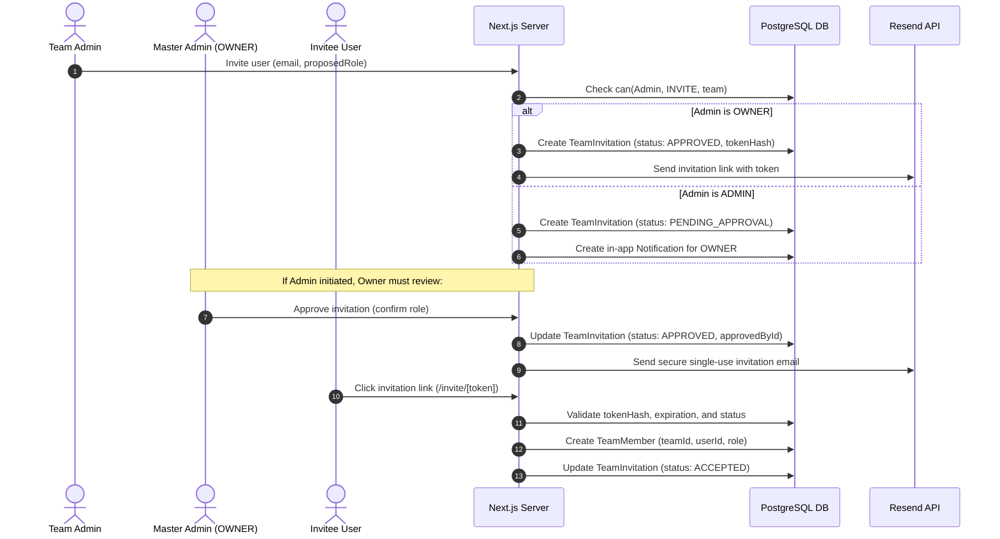
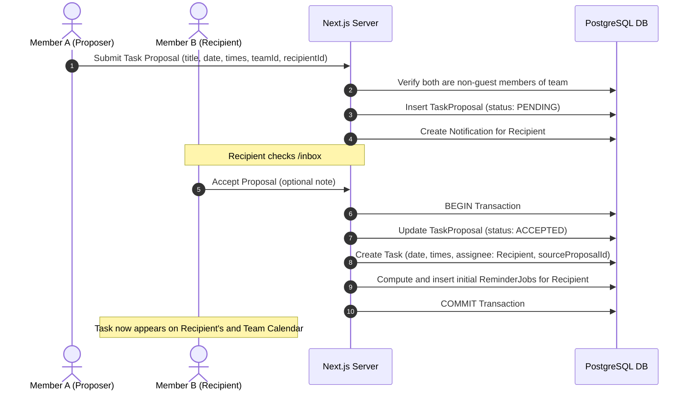
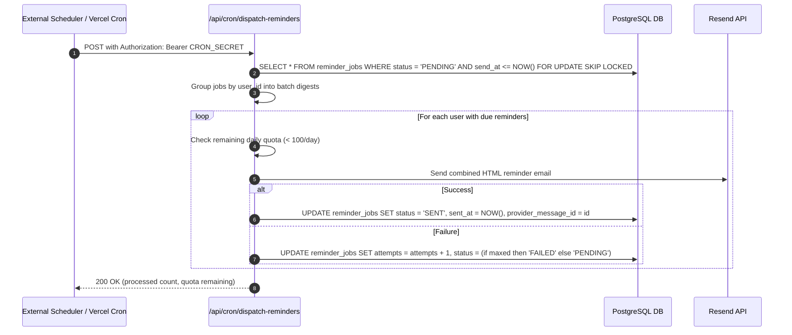

# TheWork STUDIO — System Architecture & Technical Specification

## 1. High-Level Architecture Overview

TheWork STUDIO is built on the **Next.js App Router** full-stack architecture running on Node.js/Edge environments, backed by a relational **PostgreSQL** database accessed via **Prisma ORM**, styled with **Tailwind CSS**, and utilizing the **Resend API** for email notification delivery.

```
+-------------------------------------------------------------------------+
|                              CLIENT BROWSER                             |
|  - Next.js React 19 Client Components (Interactive Calendar, TipTap)   |
|  - Auto Time Zone Detection (Intl API -> IANA TimeZone sync)            |
+------------------------------------+------------------------------------+
                                     | HTTPS (Server Actions / API Routes)
                                     v
+-------------------------------------------------------------------------+
|                        NEXT.JS APP ROUTER SERVER                        |
|                                                                         |
|  [Server Components]        [Server Actions]       [Route Handlers]     |
|   - SSR Calendar Data        - Task Mutators        - /api/auth/*       |
|   - Team Governance Views    - Proposal Decisions   - /api/health       |
|   - Notebook Viewer          - Note Autosave        - /api/cron/dispatch|
|                                                                         |
|  [Domain Logic Layer]                                                   |
|   - Authorization Engine (`can(user, action, resource)`)                |
|   - Timezone & Reminder Calculation (DST-Safe, UTC Timestamptz)         |
|   - Rate Limiter & Token Hasher (Crypto SHA-256)                        |
+------------------------------------+------------------------------------+
                                     |
                                     v
+-------------------------------------------------------------------------+
|                           DATA & EXTERNAL TIERS                         |
|                                                                         |
|  +---------------------------+       +-------------------------------+  |
|  |    PostgreSQL Database    |       |       Resend Email API        |  |
|  |  (Neon / Supabase Free)   |       |  - Transactional Invitations  |  |
|  |  - Row-level lock safety  |       |  - Reminder Batch Digests     |  |
|  |    `FOR UPDATE SKIP LOCKED|       |  - 100 emails/day budgeter    |  |
|  |  - Foreign key cascades   |       +-------------------------------+  |
|  |  - Partial unique indexes |                                          |
|  +---------------------------+                                          |
+-------------------------------------------------------------------------+
                                     ^
                                     | Trigger HTTPS (Secret Header)
+------------------------------------+------------------------------------+
|                      EXTERNAL SCHEDULER TRIGGER                         |
|  - GitHub Actions Workflow (cron: '*/10 * * * *') or cron-job.org       |
|  - Vercel Daily Cron Safety-Net Sweep                                   |
+-------------------------------------------------------------------------+
```

---

## 2. Core Workflows & Sequence Diagrams

### 2.1 Two-Step Invitation Flow (Admin Invite -> Master Admin Approval -> Member Join)



---

### 2.2 Task Proposal & Calendar Integration Flow



---

### 2.3 Reminder Job Lifecycle & Dispatcher



---

## 3. Technology Confirmation & Free-Tier Specifications

| Service / Tool | Chosen Option | Free Tier Allowance | Guardrails & Workarounds Implemented |
|---|---|---|---|
| **Framework** | Next.js 15+ / React 19 / TypeScript | Free / Open Source (MIT) | Full static and dynamic server rendering, zero paid plugins. |
| **Database** | PostgreSQL on **Neon** | 0.5 GB storage, free compute with scale-to-zero | Neon does **not** pause after 7 days of inactivity (unlike Supabase free tier which suspends inactive projects). Connection pooling is built-in. |
| **Email Service** | **Resend** REST API | 3,000 emails/month, **100 emails/day** max, 10 req/sec | Digest batching (combines multiple reminders per user into one email), daily quota counter, email sent only for invites & reminders. |
| **Cron Trigger** | GitHub Actions / cron-job.org + Vercel Cron | Unlimited free triggers (cron-job.org / GitHub Actions) | Fires every 10 minutes to `/api/cron/dispatch-reminders` with a `CRON_SECRET` header. Daily Vercel cron serves as a safety fallback. |
| **Authentication** | NextAuth (Auth.js) + Credentials & Google | Free / Open Source | JWT + Database sessions, password hashing via `bcryptjs`, browser IANA timezone auto-sync. |
| **Rich Text** | TipTap Core / Markdown Parser | Free / MIT | Clean JSON document storage + plaintext strip for search indexing. |
